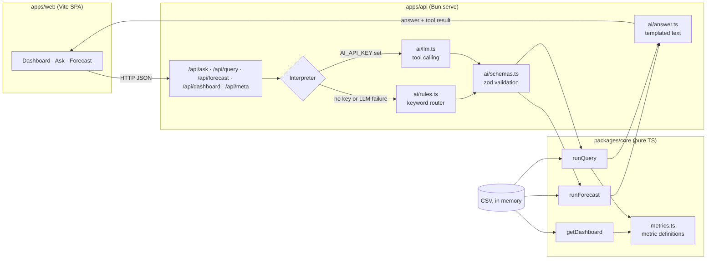

# Logistics Analytics Dashboard

A single-page analytics app over one read-only logistics dataset (400 orders, 2025). It has a
KPI dashboard, a natural-language "Ask" box, and a demand forecast with an inventory
recommendation. The AI layer only routes questions to deterministic tools; every number on
screen comes from a computation.

## Overview

- **Live URL:** TBD — pending deployment
- **Dataset:** `data/mock_logistics_data.csv` (loaded once at boot, never written)
- **Stack:** Bun 1.4 workspaces · Bun.serve (API + static web) · Vite + React 19 + TypeScript · Tailwind CSS v4 · Recharts · zod 4 · `bun test`

## Quick start

Requires [Bun](https://bun.sh) 1.4+.

```sh
bun install

# Development: web on http://localhost:5173 (Vite), API on http://localhost:3000
bun run dev

# Production-like: build the web app, then serve everything from one process on :3000
bun run build && bun run start

# Tests
bun test
```

Other scripts: `bun run typecheck` (`tsc --noEmit` per package).

Without any configuration the app runs in **rules mode** (no AI key needed). See below.

## Environment variables

| Variable | Default | Purpose |
|---|---|---|
| `AI_API_KEY` | _(unset)_ | Optional. When set, questions go through the LLM router. When unset, the deterministic rules router is used. |
| `AI_BASE_URL` | `https://api.openai.com/v1` | Any OpenAI-compatible Chat Completions endpoint. |
| `AI_MODEL` | `gpt-4o-mini` | Model name sent to `AI_BASE_URL`. |
| `PORT` | `3000` | HTTP port for the API/static server. |
| `DATA_PATH` | `data/mock_logistics_data.csv` | CSV to load at boot. |

Copy `.env.example` to `.env` to set these locally. `.env` is git-ignored.

> Changing `PORT` affects `bun run start` directly. In `bun run dev` the Vite proxy
> (`apps/web/vite.config.ts`) points at `localhost:3000`, so keep the API on 3000 there.

## Architecture



### Folder map

```
data/mock_logistics_data.csv   the dataset (read-only)
packages/core/                 computation and business logic; no HTTP, no AI
  src/types.ts                 shared contract (Order, QuerySpec, QueryResult, ForecastResult, ...)
  src/data.ts                  CSV parsing, lead_time_days, dataset metadata
  src/dates.ts                 anchor-relative ranges, ISO week / month buckets
  src/metrics.ts               metric definitions: single source of truth
  src/query.ts                 runQuery: filters, range, group/bucket, chart type, notes
  src/forecast.ts              runForecast: 3 methods, holdout MAE, interval, inventory
  src/dashboard.ts             getDashboard: fixed KPIs and charts
apps/api/                      HTTP + AI orchestration; no metric math
  src/server.ts                Bun.serve routes, serves apps/web/dist with SPA fallback
  src/data.ts                  loads the dataset once at boot
  src/ask.ts                   question -> interpretation -> validate -> tool -> answer
  src/ai/schemas.ts            zod schemas with allow-lists built from the data
  src/ai/llm.ts                OpenAI-compatible tool-calling interpreter
  src/ai/rules.ts              deterministic fallback interpreter
  src/ai/answer.ts             answer text built from tool results
apps/web/                      Vite + React SPA (Dashboard, Ask, Forecast tabs)
docs/                          requirements, dataset reference values, theme, build plan
```

### Layer separation

- **AI interpretation** (`apps/api/src/ai/llm.ts`, `rules.ts`) only produces a `QuerySpec`,
  a `ForecastSpec`, or "unsupported". It never computes anything.
- **Validation** (`apps/api/src/ai/schemas.ts`) is the trust boundary: strict zod objects,
  enums built from the loaded data, and no unknown keys.
- **Business logic** (`packages/core/src/metrics.ts`) defines each metric once. The dashboard
  and the query tool both read from it, so they cannot disagree. The forecast uses its own
  documented unit (SUM of quantity per month).
- **Computation** (`packages/core`) is pure and deterministic, so it is unit-tested against the
  reference values in `docs/dataset.md`.
- **UI** never computes metrics. It renders what the API returns.

### Why these choices

- **Bun.** One tool for install, run, test and bundling, and it runs TypeScript directly, so there is no build step for the API.
- **Vite + React, not Next.js.** This is one page with client-side tabs and no server-rendered
  content or SEO need. Vite is a plain React SPA with no framework-level routing or SSR layer to learn.
- **No database.** 400 read-only rows fit in memory and load in milliseconds. Computation is
  plain TypeScript functions over arrays, which is easy to test. A DB would add setup without
  adding any capability here.
- **No HTTP framework.** There are five endpoints plus static files. `Bun.serve({ routes })` covers
  this with no dependency. Hono or Express would add nothing.
- **Tailwind CSS v4 with small hand-rolled components** (Card, Tabs, Badge, Button, Input)
  styled from `docs/theme.md`. Copy-in component kits bring in Radix dependencies for a handful of
  components, which is more than this needs.

## Data flow

Mapped from the system flow in `docs/README.md`:

| Step | What happens | Where |
|---|---|---|
| User question | Typed in the Ask box (max 500 chars) | `apps/web/src/views/Ask.tsx` → `POST /api/ask` |
| AI interpretation | LLM tool call, or keyword rules when no key / LLM fails | `apps/api/src/ai/llm.ts`, `apps/api/src/ai/rules.ts` |
| Tool selection | `run_query`, `run_forecast`, or `refuse` / unsupported | `apps/api/src/ask.ts` |
| Structured input | Reply is re-validated against zod schemas built from the data | `apps/api/src/ai/schemas.ts` |
| Computation | `runQuery` or `runForecast` over the in-memory orders | `packages/core/src/query.ts`, `packages/core/src/forecast.ts` |
| Result | Typed result with spec, resolved range, rows, base, notes, sample orders | `packages/core/src/types.ts` |
| Explanation | Template text from the result; interpretation shown as JSON | `apps/api/src/ai/answer.ts` |
| Visualisation | `DynamicChart` picks the chart from `QueryResult.chart` | `apps/web/src/components/DynamicChart.tsx` |

The dashboard takes a shorter path: `GET /api/dashboard` returns `getDashboard(orders)`,
computed once at boot.

## AI approach

**The model routes; it does not answer.** The app is correct without a key, and the model adds
interpretation on top.

### LLM router (when `AI_API_KEY` is set)

- `apps/api/src/ai/llm.ts` sends the question to any OpenAI-compatible `/chat/completions`
  endpoint with `temperature: 0` and `tool_choice: "required"`.
- Three tools are offered: `run_query`, `run_forecast`, `refuse`. Their JSON schemas are
  generated from the same zod schemas that validate the reply (`z.toJSONSchema`), so they cannot
  drift apart. Each tool also takes a one-sentence `reasoning` string, kept for the audit panel.
- The system prompt lists the metrics with their definitions, the dimensions, the allowed values
  for carriers, regions, categories and statuses, and the anchor date. It tells the model to use
  the calendar convention below.
- The reply is parsed, and the arguments are checked by zod. Core checks them again
  (`runQuery` and `runForecast` throw on bad input). Only then is anything computed.
- The call has a 15 s timeout. Any failure (no key, HTTP error, timeout, no tool call, invalid
  arguments) falls back to the rules router. The reasoning records that the LLM was unavailable and
  why.

### Rules router (default, and the fallback)

`apps/api/src/ai/rules.ts` is deterministic keyword matching:

1. **Filter values first.** Known values (carrier, region, warehouse, city, category, SKU, client)
   are matched as whole words, case-insensitively, longest first, so `London, UK` beats `UK`.
   A capitalised word after a dimension name (e.g. `carrier Foo`) that is not a known value is
   refused, not dropped.
2. **Forecast words** (`predict`, `forecast`, `demand`, `inventory`, `stock`) route to the forecast
   tool. A SKU or category is picked up and `N months` sets the horizon (default 4).
3. **Metric words**, most specific first. `late`, `delayed` and `delay` win over the table, so
   "delivered late" is a delayed count. A rate word (`rate`, `%`, `percent`) turns that into the
   delay rate.
4. **Grain** (`daily`, `weekly`, `monthly`, `by week`, ...) and **one dimension** (`by carrier`,
   `per region`, ...). A grain and a dimension together drop the dimension, because a chart has one axis.
5. **Date range** (see the calendar convention below).
6. Nothing matches → an `unsupported` interpretation with the reason, and the UI shows the
   supported examples.

### Answers are templates

`apps/api/src/ai/answer.ts` writes the answer sentence from the tool result, using the core rows,
the base sizes and the resolved range. The model never writes a number. Rates show their count,
for example "3 of 8 orders", and small groups (base under 20) are flagged, with the leader among
larger groups named too.

### Explainability

Each answer carries an explainability panel: the tool used, the interpreter (`llm` or `rules`)
and its reasoning, the filters, the metric and its definition, the dimension or grain, the resolved
date range, the structured spec as JSON, and the underlying orders. Core notes (for example
"GLS base is only 8 orders") appear there too.

## Supported query subset

### Metrics

| Id | Label | Meaning |
|---|---|---|
| `order_count` | Orders | `COUNT(*)` |
| `delivered_count` | Delivered orders | `status = delivered` |
| `delayed_count` | Delayed orders | `status = delayed` |
| `on_time_rate` | On-time rate | delivered / delivery base |
| `delay_rate` | Delay rate | (delayed + exception) / delivery base |
| `avg_delivery_days` | Avg delivery days | average lead time over the delivery base |
| `units` | Units | `SUM(quantity)` |
| `revenue` | Revenue (gross) | `SUM(order_value_usd)` |
| `avg_order_value` | Avg order value | `AVG(order_value_usd)` |

### Dimensions (`groupBy`, `filters`)

`carrier`, `region`, `warehouse`, `origin_city`, `destination_city`, `product_category`, `sku`,
`status`, `client_id`. A query has at most one `groupBy`. Filters are AND across dimensions and
OR within one dimension's value list. The top 50 groups are returned.

### Grains (`timeGrain`)

`day`, `week` (ISO, Monday start), `month`. Buckets are chronological and zero-filled, so an empty
month such as April 2025 shows as 0, not a gap. A time-grain query has no `groupBy`.

### Ranges (`dateRange`)

Relative ranges resolve against the dataset anchor, **MAX(order_date) = 2025-12-30**, never the
wall clock. The resolved range is always shown.

| Phrase | Resolves to |
|---|---|
| `last month` | 2025-11-01 → 2025-11-30 (previous full calendar month) |
| `last 3 months` | 2025-09-01 → 2025-11-30 (3 full months before the anchor month) |
| `last N weeks` | N full ISO weeks before the anchor week |
| `last N days` | the N days ending at 2025-12-30 (inclusive) |
| `Q1` … `Q4`, or a month name | that calendar period in 2025 |

Anything else in the form `this month`, `this week`, `last quarter`, `last year`, or `last half`
is refused, not guessed.

### Chart selection

Chosen from the shape of the result, in `packages/core/src/query.ts`:

| Result shape | Chart |
|---|---|
| Single value (no grouping) | `kpi` |
| Time grain | `line` |
| `groupBy`, 15 groups or fewer | `bar` |
| `groupBy`, more than 15 groups | `table` |

### Example questions

The three required questions:

1. "Show delayed orders by week for the last 3 months" → `delayed_count`, `timeGrain: week`,
   range Sep–Nov 2025 (line chart)
2. "Which carrier has the highest delay rate?" → `delay_rate`, `groupBy: carrier` (bar chart; GLS
   leads on a base of 8 orders, so the answer also names the leader among carriers with 20+ orders)
3. "How many orders were delivered late last month?" → `delayed_count`, range Nov 2025 (KPI)

Others the rules router handles:

- "What is the on-time rate by region?" → `on_time_rate`, `groupBy: region`
- "Predict demand for PAINT for the next 4 months" → forecast, category PAINT
- "How much inventory should I plan for SKU PAINT-0168?" → forecast for that SKU (sparse SKUs get a warning)

### What is refused

Each refusal says what is wrong and is a short sentence. The UI lists the supported examples.

- Unknown filter values (`carrier Foo`) and unknown SKUs. A SKU whose category exists gets the
  real SKUs for that category as a suggestion.
- Questions with no recognised metric (for example "tell me a joke").
- Unsupported ranges (`this month`, `last quarter`, `last year`).
- Invalid specs from the API: a 400 with the zod message.
- Forecast horizon outside 1–12 months, and service level outside 0.5–0.99.

## Metric definitions

Reference values come from `docs/dataset.md`. All are computed by `packages/core` and checked by
`bun test`.

| Metric | Formula | Reference value |
|---|---|---|
| Total orders | `COUNT(*)` | **400** |
| Delivered orders | `COUNT(*) WHERE status = 'delivered'` | **304** |
| Delayed orders | `COUNT(*) WHERE status = 'delayed'` | **55** |
| Delivery base | `status IN ('delivered','delayed','exception')` | **370** |
| On-time delivery rate | `delivered / delivery base` | **82.2%** (304 / 370) |
| Average delivery time | `AVG(delivery_date − order_date)` over delivery base | **3.83 days** |
| Average delivery time (delivered only) | same, `status = 'delivered'` | **3.25 days** |
| Average order value | `AVG(order_value_usd)` | **34.24** |
| Units shipped | `SUM(quantity)` | **1310** |
| Delay rate (carrier example) | `(delayed + exception) / delivery base`, per carrier | GLS **37.5%** (base 8), USPS 25.5%, DHL 6.9% |

The dashboard and the query tool share these definitions, which live in one place,
`packages/core/src/metrics.ts`.

## Forecasting

- **Demand unit:** units (`SUM(quantity)`) per order month, from 2025-01 through 2025-12. Months
  with no orders count as 0. Units are the measure that matters for inventory planning.
- **Targets:** all products, a product category (case-insensitive), or a SKU.
- **Methods**, all simple:
  - moving average of the last 3 months
  - simple exponential smoothing, α = 0.3
  - linear trend (least-squares line)
- **Method selection:** each method is fitted on the first 9 months and scored on the last 3
  (holdout), using MAE in units. The lowest MAE wins; a tie goes to the simpler method. The chosen
  method is then refit on all 12 months. The table of MAE scores is shown in the UI.
- **Output:** point forecast per month for the requested horizon (1–12, default 4), clamped at 0.
  Interval = forecast ± 1.96·σ, where σ is the sample standard deviation of the chosen method's
  one-step-ahead errors on the history. The lower bound is floored at 0.
- **Inventory recommendation:**
  - `forecastUnits` = sum over the horizon
  - `safetyStock` = z(serviceLevel) · σ · √horizon, with a default service level of 95% (z ≈ 1.645)
  - `recommendedInventory` = ceil(forecastUnits + safetyStock)
- **Methodology text** is generated in `packages/core/src/forecast.ts` and returned with the result, so the UI and the API show the same explanation.
- **Warnings:**
  - a SKU with fewer than 3 months of non-zero demand: the forecast is unreliable, and the category is suggested instead
  - fewer than 30 units of total history: treat as indicative only

## Assumptions

These are the six decisions in `docs/PLAN.md`, plus the ones found while building.

1. **Delayed = `status = delayed`.** The data has no promised delivery date, so lateness comes from the
   status column. Elapsed-time lateness (for example lead time > 4 days, 30.8%) disagrees with status (17.8%),
   so it is not mixed in. The delay rate also counts `exception`, as documented.
2. **Delivery base = delivered + delayed + exception (370).** `in_transit` (no outcome yet) and
   `canceled` (never shipped) are excluded from rates and from average delivery time.
3. **Relative time is anchored to the data.** The anchor is MAX(order_date) = 2025-12-30. "Last month" is
   November 2025 and "last 3 months" is September–November 2025 (full calendar months before the anchor
   month). The resolved range is shown with every answer.
4. **Forecast grain is units by order month.** SKU forecasts are offered, but most SKUs have one or two
   orders, so the app warns and suggests the category.
5. **Forecast method:** three simple methods, holdout MAE selection on 3 months, interval ±1.96·σ,
   safety stock z·σ·√h.
6. **Answers are templates over tool results.** The LLM never writes numbers.

Other assumptions found in the code and data:

- **Revenue is gross.** `order_value_usd` is `quantity × unit_price_usd`, and promo discounts are not
  subtracted again.
- **Average delivery time** uses only rows with a `delivery_date`, which is every delivery-base row.
- **Order IDs are opaque.** The year embedded in `order_id` (2026) is ignored; order dates (2025) are used.
- **Dates are plain UTC calendar dates** with no timezone shifts.
- **Filters:** matching is case-insensitive and returns the dataset's spelling. Values not in the
  dataset are rejected, never silently dropped.
- **Sample size:** a group with a base below 20 is flagged as small in notes and answers.
- **Carriers are not assumed to be regional** (see `docs/dataset.md`, trap 7). The app does not infer
  carrier-to-region fit.

## Limitations

- **No SLA or promised delivery date.** Lateness is status-based only. Lead time is not compared to any target.
- **Small, synthetic dataset.** Many months have low counts (September has 18 orders). Trends and
  forecasts are indicative, and the app says so in the methodology and warnings.
- **Forecast quality.** Three simple methods on 12 months. Per-SKU forecasts are unreliable for
  most SKUs (warned). No seasonality, no external drivers, no prediction intervals beyond ±1.96σ.
- **One grouping per query** and no cross-tabulation (for example carrier × region).
- **Limited date phrases.** Relative `last N day/week/month` (plus Q1–Q4 and month names) only.
  Anything else is refused.
- **Metric set is fixed** to the nine in the table above. There is no free-form SQL and no custom metric.
- **LLM path is not tested against a live model.** Tests stub the endpoint with a local server (valid
  tool call, invalid call, HTTP error). The rules router is the tested default. With a live key, output
  quality depends on the model.
- **Data is in memory and loaded once at boot.** Changing the CSV needs a restart.
- **No authentication, no server-side query history, no rate limiting.** Anyone with the URL can call
  the API. The LLM key is held server-side only.

## Future improvements

- Load orders from a real database (Postgres) with a read-only role, and move aggregation into SQL
  once the data outgrows memory.
- Proper lateness: use promised delivery dates from the client's SLA, and show both views.
- Forecasting: hierarchical forecasts (SKU rolled up to category, with shrinkage), and seasonal
  methods once there is a year or more of history per category.
- Multi-dimension queries (`groupBy` plus a second dimension) and a richer date vocabulary
  (`this month`, `year to date`, custom week numbers).
- LLM evaluation: a fixed set of questions with expected specs, run on each model change, so routing
  quality is measured rather than assumed.
- Query history and caching of identical specs; authentication if the data becomes client-specific.

## Testing

Run `bun test`. The result on this commit is recorded in `docs/EVIDENCE.md`.

- **Core (`packages/core/test`, 50 tests):**
  - data: CSV parsing, lead time, metadata
  - query: filters, ranges, buckets, chart selection, notes, validation errors
  - forecast: history sums, holdout selection, non-negative output, safety stock, sparse-SKU warning, errors
  - dashboard: the reference values from `docs/dataset.md` (400 / 304 / 55 / 370 / 82.2% / 3.83 / 34.24 / 1310)
- **API (`apps/api/test`, 32 tests):**
  - rules router on the three example questions, forecast phrasing and a nonsense question
  - templated answers
  - server: routes, validation errors (400), and `/api/ask` end-to-end over HTTP with a started server

Not covered by automated tests: a live LLM call, and the browser UI.

## Deployment

The app is one container: the Bun server serves the API and the built web app from `apps/web/dist`.

- **Docker:** `Dockerfile` (two stages, `oven/bun:1`). The runtime image has production dependencies
  only and runs as the `bun` user on port 3000.

  ```sh
  docker build -t logistics .
  docker run -p 3000:3000 -e AI_API_KEY=... logistics   # AI_API_KEY is optional
  ```

- **Render:** `render.yaml` is a Blueprint for a Docker web service on the free plan with the health
  check `/api/health`. Set `AI_API_KEY` in the Render dashboard as a secret (`sync: false`, so it is never
  in the repo).
- **Fly.io:** `fly.toml` (`internal_port = 3000`, health check `/api/health`, 256 MB shared CPU). Change
  `app` to a globally unique name, run `fly launch --no-deploy`, then `fly secrets set AI_API_KEY=...`
  and `fly deploy`.

No secrets are in the repository. `.env` and `node_modules` are excluded from the Docker build context.

## AI usage disclosure

This project was built with AI coding agents. A coordinating pi agent (Claude) planned the work into
tasks and delegated them to pi worker agents through Orca orchestration. The owner set the requirements,
reviewed the results, and the coordinator checked outputs against the reference values in
`docs/dataset.md`.

The AI in the running app is an optional router (see [AI approach](#ai-approach)). It only chooses a
tool and its arguments. No model output is used as data at runtime: every number comes from the
deterministic core, and the answer text is a template over those results.
