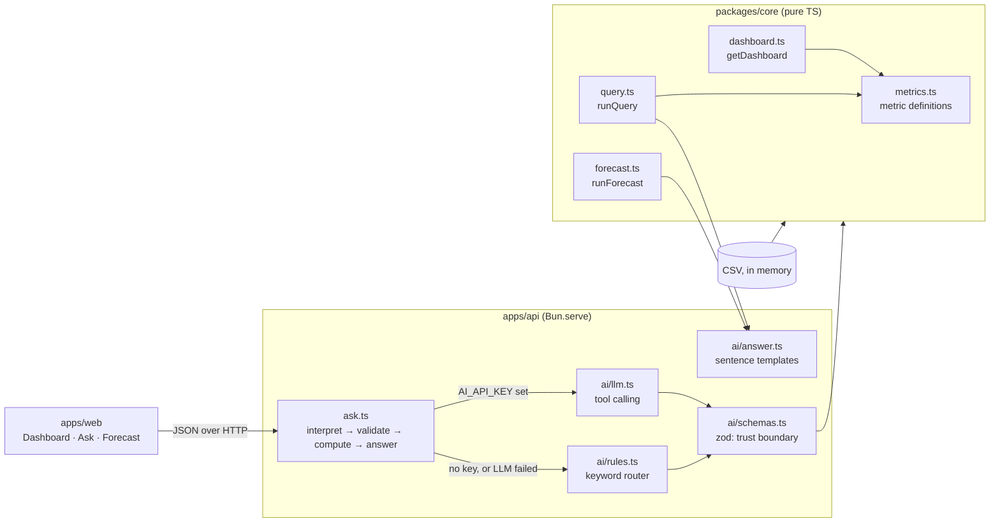

# Logistics Analytics Dashboard

A single-page analytics app over one read-only logistics dataset (400 orders, 2025): a KPI dashboard, a natural-language **Ask** box, and a **Forecast** tab with an inventory recommendation. The AI layer only routes a question to a deterministic tool. Every number on screen is computed by `packages/core`.

**Live URL:** https://spaceship-logistics-eby.fly.dev

- **Data:** `data/mock_logistics_data.csv`, loaded once at boot, never written.
- **Stack:** Bun 1.4 workspaces · Bun.serve (API + built web app) · Vite + React 19 + TypeScript · Tailwind CSS v4 · Recharts 3 · zod 4 · `bun test`

## Setup

Requires [Bun](https://bun.sh) 1.4+. No API key is needed: without one, questions use the rules router.

```sh
bun install
bun run dev                      # web on :5173 (Vite), API on :3000; Vite proxies /api to :3000
bun run build && bun run start   # one process on :3000, serves apps/web/dist
bun test                         # all workspaces
bun run typecheck                # tsc --noEmit per package
```

To use the LLM router, copy `.env.example` to `.env` (git-ignored) and set `AI_API_KEY`.

### Environment variables

| Variable | Default | Purpose |
|---|---|---|
| `AI_API_KEY` | _(unset)_ | **Secret, optional.** Set: questions go through the LLM. Unset: rules router only. Never commit it. |
| `AI_BASE_URL` | `https://ai.sumopod.com/v1` | Any OpenAI-compatible endpoint that supports tool calls. |
| `AI_MODEL` | `gpt-6-luna` | Model name sent to `AI_BASE_URL`. `glm-5.3-flash` is the cheaper, slower alternative. |
| `AI_REASONING_EFFORT` | `none` | Sent as `reasoning_effort`. `gpt-6-luna` rejects tool calls without `none`. Empty = not sent. |
| `PORT` | `3000` | HTTP port. Keep it at 3000 for `bun run dev`, because the Vite proxy targets it. |
| `DATA_PATH` | `data/mock_logistics_data.csv` | CSV loaded at boot. |

These are read in `aiConfigFromEnv` (`apps/api/src/ai/llm.ts`).

## Architecture



```
packages/core/src  pure computation: types, metrics (9 definitions), query, forecast, dashboard, dates, data
apps/api/src       server.ts (routes, rate limit, static files), ask.ts, ai/* (llm, rules, schemas, answer)
apps/api/scripts   eval-llm.ts: live check of the LLM router (12 fixed questions)
apps/web/src       Vite + React SPA: views Dashboard, Ask, Forecast
```

### Key design decisions

- **Structured queries, not SQL.** The interpreter produces a typed spec: an allow-listed metric, dimension, grain, filters and date range. No SQL is generated or run.
- **Zod is the trust boundary.** Allowed values come from the loaded data, objects are strict, and unknown keys are rejected. Core validates again, so the API routes get the same checks.
- **Metrics are defined once.** `metrics.ts` feeds the KPIs, the query tool, the chart labels and the explanations, so they cannot disagree.
- **The AI never answers.** Answer sentences are templates over core results. No model output reaches a number.
- **No database, no HTTP framework.** 400 read-only rows fit in memory. `Bun.serve({ routes })` covers five endpoints plus static files.
- **Vite SPA, not Next.js.** One page with client-side tabs; no server rendering or SEO need.

### Data flow

1. The user types a question (max 500 characters) in the Ask box → `POST /api/ask`.
2. `interpret()` (`ask.ts`) uses the LLM tool call when `AI_API_KEY` is set, otherwise the rules router. Either way it returns `query`, `forecast` or `unsupported`.
3. The spec is validated with zod (`ai/schemas.ts`). Core validates it again.
4. `runQuery` or `runForecast` computes over the in-memory orders. `ai/answer.ts` writes the sentence.
5. The response carries the interpretation, result, rows and notes. The UI shows the answer, a chart picked from the result shape (`DynamicChart`), and a Details panel.

The dashboard skips steps 1–3: `GET /api/dashboard` returns `getDashboard(orders)`, computed once at boot.

## AI approach

**The model routes; it does not answer.** The app works fully without a key. The LLM covers phrasing the rules do not.

### How tools are selected (LLM path)

- `llm.ts` calls `/chat/completions` with `temperature: 0`, `tool_choice: "required"` and a 15 s timeout.
- Three tools: `run_query`, `run_forecast`, `refuse`. Their parameter schemas are generated from the zod schemas that validate the reply (`z.toJSONSchema`), so they cannot drift apart. Each call also has a one-sentence `reasoning`, which the UI shows.
- The system prompt lists the metric definitions, dimensions, allowed values, the anchor date, and rules for ranges, grouping and status filters.
- Enums with more than 20 values (SKUs, cities, client IDs) are not sent; the prompt gives an example instead. One measured question went from 7,990 prompt tokens (glm, untrimmed schema) to about 1,970 on glm, or about 1,570 on gpt-6-luna. zod still enforces the full allow-list on the reply.
- Any failure (HTTP error, timeout, no tool call, invalid arguments) falls back to the rules router. The reasoning then ends "(AI unavailable, used keyword matching.)", and the header badge shows **AI fallback** until the next successful call.
- `tidyQuery` removes a status filter that restates the metric (`delayed_count` with status delayed) and a limit of 1.
- Successful LLM interpretations are cached in memory per server instance, keyed by the trimmed, lower-cased question (500 entries, oldest dropped). Rules results and failures are not cached.
- `/api/ask` is rate-limited to 20 requests per minute per client IP, **only when a key is set**. Behind Fly, the client IP comes from `fly-client-ip`.
- `/api/health` reports `{ aiMode: "llm", model, aiStatus: "ok" | "failing" }`, or `{ aiMode: "rules" }` without a key.

### How tools are selected (rules path)

`ai/rules.ts` is deterministic keyword matching. Its reasoning is plain English and is shown to users.

1. **Refusals first.** Promotion words ("promo", "promotion") are refused. A filter-style word with an unknown value ("carrier Foo", "SKU PAINT-9999") is refused. For an unknown SKU whose prefix is a real category, the reply suggests that category.
2. **Filters.** Known values match as whole words, case-insensitively, longest first, so `London, UK` beats `UK`. This covers carrier, region, warehouse, city, category (plurals too), SKU, client, and status words (`canceled`, `in transit`, `exception`). City short names work: "London" means `London, UK`; "from X" is an origin and "to X" a destination. A city on the wrong side is refused with the fix.
3. **Forecast.** `predict`, `forecast`, `demand`, `inventory` or `stock` routes to the forecast tool. A SKU or category is the target. `N months` sets the horizon (default 4); anything outside 1–12 is refused.
4. **Metric.** `late`, `delayed` or `delay` give `delayed_count`, or `delay_rate` with a rate word. `deliver` verbs give `delivered_count`. Also: on-time, lead time, AOV, revenue, units, orders. Superlatives with no measure: "reliable" or "best" → on-time rate, "worst" → delay rate, "slowest" or "fastest" → average delivery time. A status filter alone counts orders. A carrier, region or warehouse alone gets the on-time rate. No recognised measure → refused.
5. **Grain and grouping.** `daily`, `weekly`, `monthly`, `trend`, `over time` set the time grain. The first dimension named is the grouping. With a grain, or with a second grouping, the extra dimension is dropped and the reasoning says "one grouping per question". `top N` and `bottom N` set a limit; `lowest` and `fewest` sort ascending. Two or more values of one dimension ("UPS and FedEx") compare them.
6. **Ranges.** `last N days/weeks/months`, `Q1`–`Q4`, and month names (in the data year). `this month`, `last quarter`, `last year` and `last half` are refused.

The rules router only understands the phrasings above. Anything else is refused with the supported examples; it is never guessed.

### Live LLM check

`apps/api/scripts/eval-llm.ts` runs 12 fixed questions through the live endpoint and checks the returned spec, not the wording. Run it with `AI_API_KEY=... AI_MODEL=... bun apps/api/scripts/eval-llm.ts`. Results are in `docs/EVIDENCE.md`.

| Model | Passed | Median latency | Median prompt tokens |
|---|---|---|---|
| `gpt-6-luna` (default) | 12/12 | 1.7 s | 1,566 |
| `glm-5.3-flash` | 11/12 (see note) | 5.0 s | 1,971 |

For glm-5.3-flash, 9/12 passed on the first run. After one prompt fix, the two failing questions that were re-run ("show orders from London" and the prompt-injection case) passed; "How many orders were canceled?" was not re-run after the fix.

### Answers and explainability

- Answers are templates over core results (`ai/answer.ts`). Rates show their base ("3 of 8 orders"). Groups with fewer than 20 orders are flagged, and when the leader is small, the leader among larger groups is also named.
- Each answer has a **Details** panel: reasoning and source (LLM or rules), metric and definition, the structured spec as JSON, the result table, and the first 100 matching orders with the total count.
- Each dashboard chart has a **View data** panel: the scope line (metric, grouping, date range, filters), the definition, and the rows behind the chart.
- Core notes (such as "GLS: small base (8 orders)") appear under each answer.

## Supported queries (documented subset)

**Metrics** (`metrics.ts`):

| Id | Meaning |
|---|---|
| `order_count` | Orders: `COUNT(*)` |
| `delivered_count`, `delayed_count` | `status = delivered`, `status = delayed` |
| `on_time_rate` | delivered ÷ delivery base |
| `delay_rate` | "Delay rate (delayed + exception)": (delayed + exception) ÷ delivery base |
| `avg_delivery_days` | average `delivery_date − order_date` over the delivery base |
| `units`, `revenue`, `avg_order_value` | `SUM(quantity)`, `SUM(order_value_usd)` (gross), `AVG(order_value_usd)` |

Delivery base = `delivered + delayed + exception` (370 orders). In-transit and canceled orders are excluded from rates.

**Dimensions** (`groupBy`, `filters`): carrier, region, warehouse, origin_city, destination_city, product_category, sku, status, client_id. One `groupBy` per query. Filters are AND across dimensions and OR within one. At most 50 groups are returned.

**Time grains:** day, week (ISO, Monday start), month. Buckets are chronological and zero-filled. A time query has no `groupBy`.

**Date ranges** resolve against the anchor `MAX(order_date) = 2025-12-30`, never the wall clock. The resolved range is always shown.

| Phrase | Resolves to |
|---|---|
| `last month` | 2025-11-01 → 2025-11-30 |
| `last 3 months` | 2025-09-01 → 2025-11-30 (three full months before the partial anchor month, December) |
| `last N weeks`, `last N days` | N full ISO weeks before the anchor week; the N days ending 2025-12-30 |
| `Q1`–`Q4`, a month name | that period in 2025 |

**Chart choice** follows the result shape: single value → KPI; time grain → line; grouping of 15 groups or fewer → bar; more → table.

**Examples** (rules mode, verified in `docs/EVIDENCE.md`):

- "Show delayed orders by week for the last 3 months" → line chart; 9 delayed orders from 1 Sep to 30 Nov 2025, busiest week 2.
- "Which carrier has the highest delay rate?" → bar chart; GLS 37.5% on 8 orders, so the answer also names USPS (25.5%, 47 orders) as the leader among carriers with 20+.
- "How many orders were delivered late last month?" → KPI; 4 delayed orders placed in November 2025.

**Refused, with a reason:** unknown filter values and SKUs; no recognised measure; unsupported ranges; promo filters; forecast horizons outside 1–12 months. Invalid API request bodies return 400.

**Forecast:** target is all products, a category, or a SKU. The unit is units (`SUM(quantity)`) per order month, Jan–Dec 2025.

- Three methods are fitted on the first 9 months and scored on the last 3 by MAE in units: 3-month moving average, simple exponential smoothing (α = 0.3), and linear trend. The lowest MAE wins, ties go to the simpler method, and the winner is refit on all 12 months.
- Interval: forecast ± 1.96·σ, floored at 0.
- Recommended inventory = forecast total + z·σ·√horizon at a 95% service level (the API accepts 0.5–0.99), rounded up.
- Methodology text comes from core and is returned with the result.
- Warnings: fewer than 3 months of non-zero demand for a SKU (the category is suggested), and fewer than 30 units of history in total.

## Assumptions

- **Delayed = `status = 'delayed'`.** The data has no promised delivery date, so lateness comes only from the status column. Elapsed time (lead time over 4 days) is not mixed in, because it disagrees with status.
- **Delay rate counts `exception` too, so it is not the "Delayed" KPI.** The Delayed KPI is 55 orders (55 ÷ 370 = 14.9%). Delay rate (delayed + exception) is 66 ÷ 370 = 17.8%. The 11 exception orders explain the gap. The labels say which one is shown.
- **Delivery base = delivered + delayed + exception (370).** `in_transit` (no outcome yet) and `canceled` (never shipped) are left out of rates and average delivery time.
- **All date filters use `order_date`.** "Delivered late last month" therefore means delayed orders placed in November 2025: **4**. Counting by delivery date would give 3. Dates are plain UTC calendar dates.
- **Relative time is anchored to the data** (2025-12-30), not to today. "Last month" is November 2025. "Last 3 months" is September–November 2025, the three full calendar months before the partial anchor month, December.
- **Revenue is gross.** `order_value_usd` already equals quantity × unit price, so promo discounts are not subtracted again.
- **Forecasts are per order month, in units.** Most SKUs have one or two orders, so SKU forecasts come with warnings and category suggestions.
- **The year in `order_id` is ignored** (it reads 2026, while dates are 2025).
- **Groups with fewer than 20 orders are "small"** and are flagged. A rate leader with a small base is reported next to the leader among larger groups.
- **Carriers are not regional** (see `docs/dataset.md`). The app does not infer carrier-to-region fit.

## Limitations

- **"Why" questions get the computed number, not a cause.** For example, "why were orders delayed in October" returns the count and breakdown. The data has no causal fields, so the app does not explain.
- **No SLA or promised delivery date.** Lateness is status-based only.
- **Small, synthetic dataset.** 400 orders; some months have fewer than 20 (September has 18). Trends and forecasts are indicative, and the app says so.
- **Forecasts are simple.** Three methods on 12 months, with no seasonality or external drivers. Per-SKU forecasts are unreliable for most SKUs.
- **One grouping per query** and no cross-tabulation (for example carrier × region).
- **Phrase-based rules router.** It covers the phrasings above; other wording is refused.
- **Limited date phrases.** `this month`, `last quarter`, `last year` and year-to-date are refused.
- **Fixed metric set** of nine. No free-form SQL and no custom metrics.
- **LLM quality is measured on 12 questions only.** The eval script costs money to run and is not part of `bun test`. Results can change with the model.
- **Data is in memory and loaded at boot.** A changed CSV needs a restart.
- **No authentication and no query history.** Anyone with the URL can call the API. The only rate limit is on `/api/ask` in LLM mode. It is in memory, per process, and resets on restart.

## Future improvements

- Load orders from Postgres with a read-only role, and aggregate in SQL once the data outgrows memory.
- Use promised delivery dates when a client provides them, and show status-based and time-based lateness side by side.
- Forecasting: roll SKUs up to categories with shrinkage, and add seasonal methods once a category has a year or more of history.
- Multi-dimension queries and a wider date vocabulary (`this month`, year to date).
- Run the LLM eval on each model or prompt change, with cost limits.
- Shared cache and rate limit (for example Redis) once there is more than one instance.

## Testing

`bun test` runs every workspace: **144 tests in 11 files** at the time of writing. The command prints the current count.

- **Core** (`packages/core/test`): CSV parsing and lead time; query filters, ranges, buckets, charts and notes; forecast selection, safety stock and warnings; dashboard values against `docs/dataset.md` (400 / 304 / 55 / 370 / 82.2% / 3.83 days / 34.24 / 1310 units).
- **API** (`apps/api/test`): rules examples and refusals; LLM tool-call handling, including invalid calls and HTTP errors falling back to rules (stubbed endpoint); answer templates; routes, 400 errors, and `/api/ask` end to end.
- **Web** (`apps/web/src`): header AI badge states, formatting helpers, and the dashboard data tables.

Not automated: a live LLM call (use `eval-llm.ts`) and the browser UI.

## Deployment

The app is one process. The Bun server handles `/api/*` and serves the built web app from `apps/web/dist`. The health check is `GET /api/health`.

- **Fly.io** (`fly.toml`): one always-on machine (`min_machines_running = 1`, `auto_stop_machines = "off"`), `internal_port = 3000`, HTTPS forced, health check on `/api/health`, 256 MB shared CPU. Its `[env]` block sets the AI defaults. Steps: change `app` to a unique name, `fly apps create <name>`, run `fly secrets set AI_API_KEY=...` (optional), then `fly deploy`.
- **Docker** (`Dockerfile`): two stages on `oven/bun:1`; the runtime image has production dependencies only, runs as `bun` and exposes 3000. `docker build -t logistics . && docker run -p 3000:3000 -e AI_API_KEY=... logistics` (key optional).

- **Render** (`render.yaml`): a Blueprint for a Docker web service with the same health check. `AI_API_KEY` is set in the dashboard (`sync: false`).

No secrets are in the repository. `.env*`, `node_modules`, `dist` and `.git` are excluded from the Docker build context (`.dockerignore`). The container build is not recorded as run in `docs/EVIDENCE.md` (§0).

## AI usage disclosure

This project was built with AI coding agents. A coordinating agent (Claude, running in pi) split the work into tasks and dispatched them to worker agents through Orca orchestration. The owner set the requirements and reviewed the results. Outputs were checked against `docs/dataset.md` and the test suite.

At runtime the AI is optional. It only chooses a tool and its arguments. Every number comes from the deterministic core, and answer text is a template over those results.
